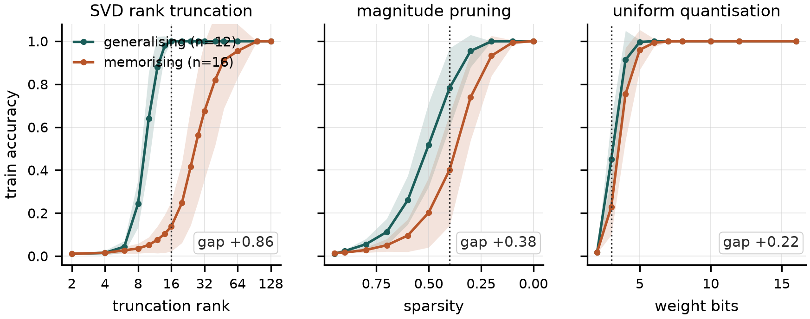
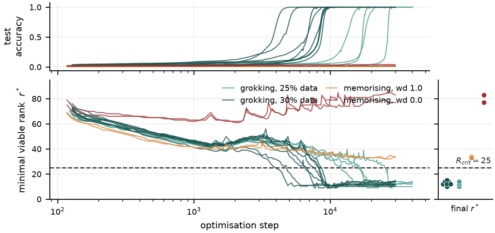

# grokzip

**Not All Compression Is Equal: Rank Separates Memorisation from Generalisation in Grokking**


Project for _Deep Learning and Applied AI_, a.y. 2025/2026, Sapienza University of Rome.
Giovanni Ciarravano — `ciarravano.1989209@studenti.uniroma1.it`

📄 **[Two-page report (PDF)](report/main.pdf)**

> **TL;DR** — Can you tell whether a network has *memorised* or *generalised* without a held-out set?
> Post-hoc SVD rank truncation can: it separates the two phases with a +0.86 gap in retained
> training accuracy, against +0.38 for pruning and +0.22 for quantisation. A detector built on the
> *minimal viable rank* r\* finds 12/12 grokking runs and 0/4 controls. It does **not** anticipate
> grokking, though: that negative result is reported in full below.

---

## The question

During grokking a network reaches perfect training accuracy thousands of steps before it
generalises. In that interval the training signal is saturated and says nothing about
whether the network found an algorithm or a lookup table. Telling the two apart normally
requires a held-out set.

This project asks whether **post-training compression** can do it instead. The intuition:
a lookup table needs every entry stored precisely, whereas a rule tolerates perturbation.
If so, compressing the weights and re-running the _training_ data is enough — no held-out
labels, no prior knowledge of the circuit the network is supposed to have found.

Three compression operators are applied post hoc, at matched points on the trajectory,
with no retraining:

- **SVD rank truncation** to rank `r` (optimal rank-`r` approximation, Eckart–Young)
- **magnitude pruning** at sparsity `s` (one-shot, global)
- **uniform quantisation** at `b` bits (symmetric, per-tensor, absmax scale)

---

## Findings

### 1. Only rank separates the two phases

Retained training accuracy at each operator's reported operating point, over 12
generalising and 16 memorising anchors (mean ± s.d. across runs):

| operator      | generalising     | memorising   | gap       |
| ------------- | ---------------- | ------------ | --------- |
| **rank r=16** | **1.000 ± .000** | 0.137 ± .115 | **+0.86** |
| prune s=0.40  | 0.783 ± .185     | 0.402 ± .260 | +0.38     |
| quant. 3 bit  | 0.450 ± .186     | 0.229 ± .130 | +0.22     |

At rank 16 _every_ generalising anchor retains its full training accuracy, with zero
variance across runs. Pruning and quantisation separate two to four times less, with
overlapping error bands.



### 2. Three disjoint populations, separated without a test set

The **minimal viable rank** is defined on training data only:

```
r*(θ) = min { r : acc_train(trunc_r(θ)) ≥ 0.9 · acc_train(θ) }
```

Tracked across 2,564 checkpoints from 16 runs, it shows **two distinct descents**. The
first, from ≈70 to ≈35, happens even without generalisation (`nc_mem` makes it) but not
without weight decay (`nc_wd0` does not). The second, below ≈32, happens only under
generalisation.

| condition | data | weight decay | runs | final r\* | trajectory min r\* | detected |
| --------- | ---- | ------------ | ---- | --------- | ------------------ | -------- |
| `main`    | 30%  | 1.0          | 8    | 10–15     | 9–11               | 8/8      |
| `long`    | 25%  | 1.0          | 4    | 10–14     | 9–10               | 4/4      |
| `nc_mem`  | 20%  | 1.0          | 2    | 33–34     | 32                 | 0/2      |
| `nc_wd0`  | 30%  | 0.0          | 2    | 77–83     | 61–62              | 0/2      |



The controls are complementary. `nc_wd0` rules out long training as the cause;
`nc_mem` carries the _same_ weight decay as `main`, so any signal that is a by-product
of weight shrinkage would have to appear there too. Neither ever enters the generalising
band, at any point in training.

**Detector.** `t_detect = min { t : r*(t) ≤ R_crit }`, with `R_crit` fixed in advance as
the midpoint between the largest final r* (15) and the smallest plateau r* (35) over
`main` alone — giving **R_crit = 25**, with a margin of 10 to the worst positive and 7 to
the control minimum. Applied unchanged to `long` and the controls.

Calibration uses the labels of `main`; the detector itself does not. `long` is a
different experimental condition (25% of data, grokking at 13–26k steps instead of
4–9k), so transferring the threshold there unchanged is out-of-condition validation.

### 3. It does not fire early — a negative result

With `t_grok` the first step at test accuracy ≥ 0.5:

- median lead time **−130 steps**, mean −436
- **9 of 12** runs negative
- exact two-sided sign test on the paired design: **p = 0.146** — not significant

We do not reject the null. In the `main` runs the offsets span −298 to +365 steps against
plateaus of 3,675–8,525, i.e. below 10% of the plateau, and at or below the ≈152-step
checkpoint spacing. The detector **replaces** held-out labels after calibration; it does
not anticipate grokking.

### 4. Consistency with the Fourier circuit

A spectral analysis of the digit embeddings provides an independent check:

| group               | spectral concentration (top 6 of 48) |
| ------------------- | ------------------------------------ |
| generalising (n=12) | 0.952 ± 0.013                        |
| controls (n=4)      | 0.238 ± 0.073                        |
| white-noise level   | 6/48 = 0.125                         |

Counting key frequencies `k` (energy above 10× the median), the inequality **r\* ≥ 2k**
— expected since each frequency needs a sine and a cosine component — holds in **12/12
runs**, mean margin +3.42. Two independently constructed measures, one functional and one
spectral, agree.

Pearson correlation between 2k and r\* is +0.44 (p = 0.15, n = 12): weak, as expected,
since 2k is a lower bound rather than a point prediction.

**No frequency is shared by all runs** (27 distinct frequencies across the 12), so r*
recognises the dimensionality of the computed circuit rather than one particular solution.
Spectral concentration separates just as cleanly and needs no data at all — but only
someone who already knows the solution is Fourier can construct it. r* requires no such
knowledge.

---

## Setup

One-layer transformer on `(a + b) mod 97`:

- `d_model = 128`, 4 heads, `d_mlp = 512`, 221,952 parameters
- **no LayerNorm, no dropout, no biases** — the absence of LayerNorm keeps the embedding
  matrix directly interpretable in the Fourier basis
- full-batch AdamW, `lr = 1e-3`, `β = (0.9, 0.98)`, weight decay 1.0 (0.0 in `nc_wd0`)
- 30,000 steps (40,000 for `long`)

The four conditions were fixed by a scan over the training fraction, which recovers three
of the four regimes described by Liu et al. (2022):

| fraction | examples | t_mem | t_grok | regime        |
| -------- | -------- | ----- | ------ | ------------- |
| 0.20     | 1881     | 125   | never  | memorisation  |
| 0.25     | 2352     | 125   | 17825  | grokking      |
| 0.30     | 2822     | 125   | 6775   | grokking      |
| 0.35     | 3293     | 150   | 3875   | grokking      |
| 0.40     | 3763     | 150   | 1175   | comprehension |

0.30 was chosen over 0.25 because it is further from the memorisation boundary at 0.20,
where the time to grokking has high variance across seeds. 0.25 was kept as the
out-of-condition validation set.

---

## Repository structure

```
src/grokzip/
    data.py           modular-arithmetic dataset, deterministic split
    model.py          one-layer transformer
    train.py          full-batch loop, Config, grokking regime diagnostics
    checkpoints.py    hybrid log/linear grid, float32 checkpoint saving
    compression.py    the three operators: quantize, prune, truncate_rank
    measure.py        Evaluator: accuracy of a state_dict on train and test
    threshold.py      minimal viable rank r*, monotonicity check
    anchors.py        automatic selection of comparison checkpoints
    sweep.py          compression grids and systematic evaluation
    detector.py       R_crit calibration, exact sign test
    fourier.py        DFT of embeddings, key-frequency counting
    figdata.py        data aggregation for figures
    style.py          shared figure style

scripts/              one executable per phase
results/              all intermediate CSVs
figures/              report figures
report/               LaTeX source of the two-page report
```

---

## Reproducing the results

The project is managed with [uv](https://docs.astral.sh/uv/) and requires Python ≥ 3.12.
PyTorch is pulled from the CUDA 12.8 wheel index (see `pyproject.toml`); edit
`[tool.uv.sources]` if you need a CPU-only or different CUDA build.

```bash
git clone https://github.com/GiovanniCiarra/DLAI-Project2026.git
cd DLAI-Project2026
uv sync
```

### Regenerate the figures (no GPU, ~1 minute)

All intermediate results are committed in `results/`, so the figures and the summary
statistics can be rebuilt without retraining:

```bash
uv run python scripts/make_figures.py
```

### Full pipeline (GPU recommended)

Checkpoints are not committed (they are written to `checkpoints/`), so the full pipeline
starts from training:

```bash
# 0. (optional) regime scan over the training fraction
uv run python scripts/scan_fraction.py

# 1. train the four conditions and save checkpoints
uv run python scripts/run_experiment.py --condition main
uv run python scripts/run_experiment.py --condition long
uv run python scripts/run_experiment.py --condition nc_mem
uv run python scripts/run_experiment.py --condition nc_wd0

# 2. compression sweep at the anchors, and r* along every trajectory
uv run python scripts/run_sweep.py
uv run python scripts/run_trajectories.py

# 3. detector calibration + sign test, Fourier analysis
uv run python scripts/run_detector.py
uv run python scripts/run_fourier.py
uv run python scripts/analyze_fourier.py

# 4. figures
uv run python scripts/make_figures.py
```

Robustness checks (`check_monotonicity.py`, `check_retention.py`, `check_test_under_rank.py`,
`sensitivity.py`) and plain-text reports (`report_sweep.py`, `report_trajectories.py`) can
be run the same way once the CSVs exist. `check_retention.py` also needs the trajectories
at 80% and 95% retention:

```bash
uv run python scripts/run_trajectories.py --retention 0.8  --out results/trajectories_r80.csv
uv run python scripts/run_trajectories.py --retention 0.95 --out results/trajectories_r95.csv
```

